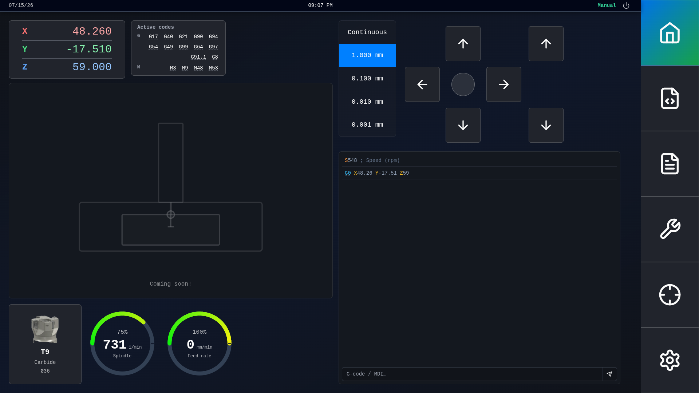
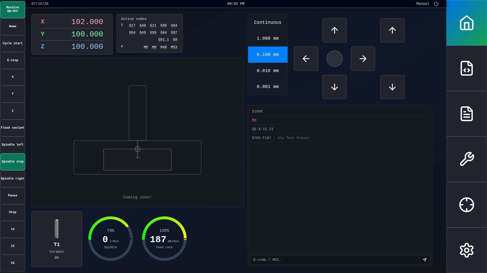
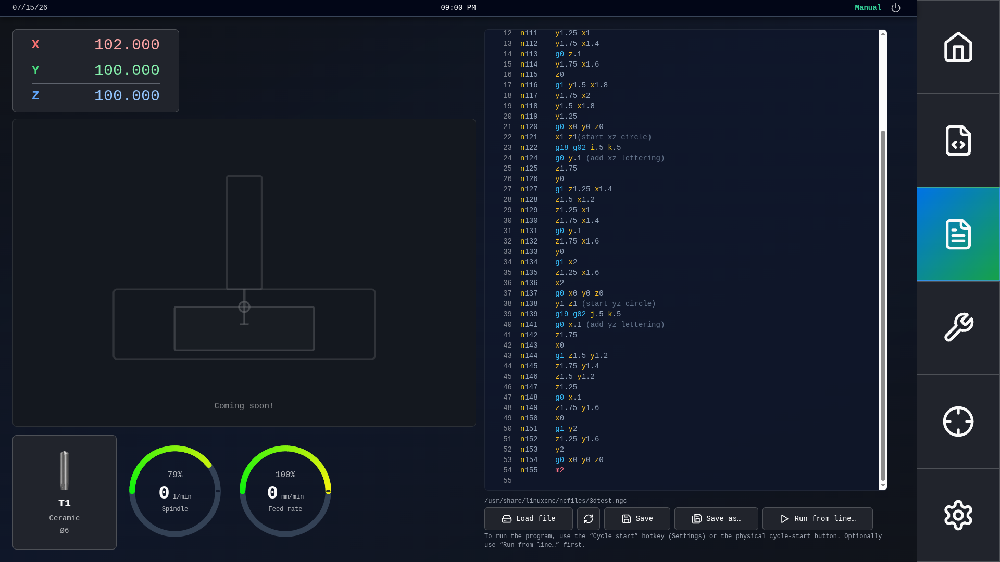
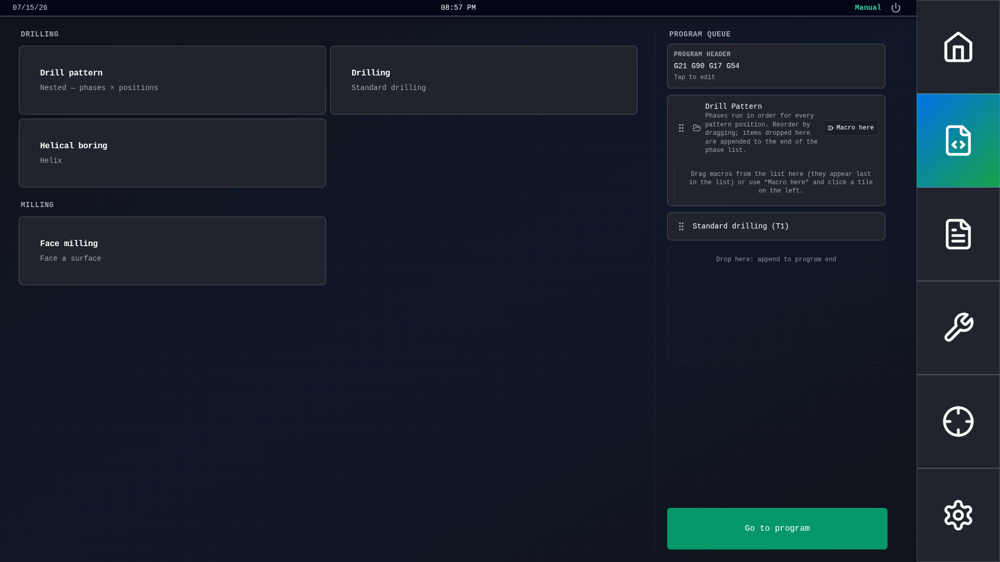
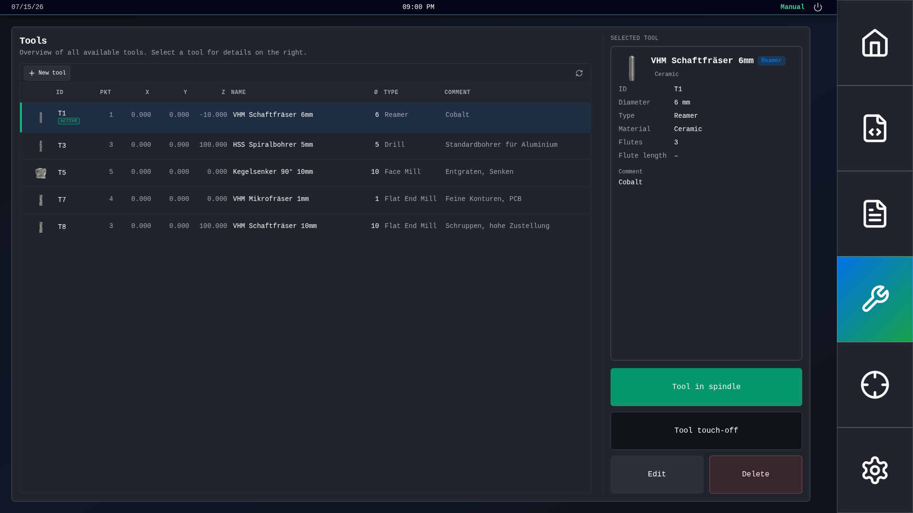
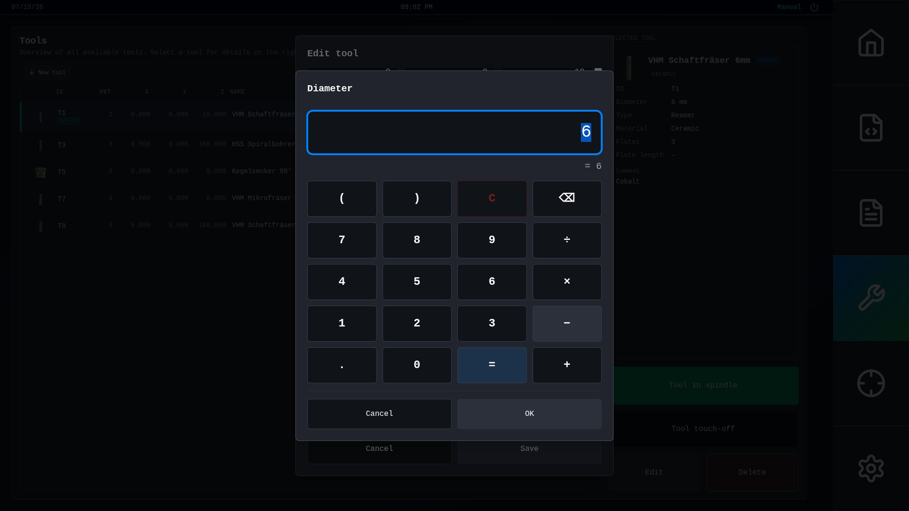
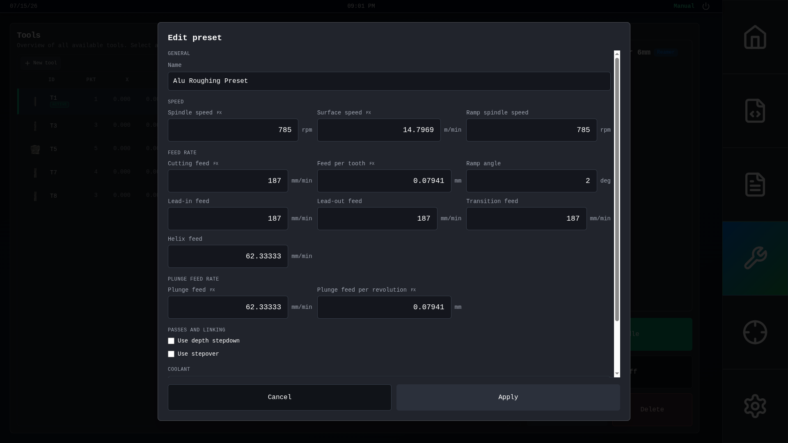

# plasmaweb

Web-based GUI for LinuxCNC — jog, tool table, program editor, macros, and machine control in a touch-friendly browser UI (similar role to gmoccapy).

## Screenshots

<table>
  <tr>
    <td width="50%">
      
      <p align="center"><sub>Home — jog, DRO, MDI, spindle &amp; feed</sub></p>
    </td>
    <td width="50%">
      
      <p align="center"><sub>Virtual sidebar — machine, spindle, coolant</sub></p>
    </td>
  </tr>
  <tr>
    <td width="50%">
      
      <p align="center"><sub>Program editor — load, edit, run from line</sub></p>
    </td>
    <td width="50%">
      
      <p align="center"><sub>Macros — drilling, milling, program queue</sub></p>
    </td>
  </tr>
  <tr>
    <td width="50%">
      
      <p align="center"><sub>Tool table — offsets, materials, touch-off</sub></p>
    </td>
    <td width="50%">
      
      <p align="center"><sub>Touch keypad — expressions &amp; units</sub></p>
    </td>
  </tr>
</table>

<details>
<summary>More screenshots</summary>

<p align="center">
  
  <br>
  <sub>Machining presets — speeds, feeds, plunge &amp; coolant</sub>
</p>

</details>

## Install (LinuxCNC controller)

You do **not** need Node.js on the machine. Download a pre-built release tarball from **[GitHub Releases](https://github.com/salomom/plasmaweb/releases)**.

```bash
tar xzf plasmaweb-1.0.0-linux.tar.gz
cd plasmaweb-1.0.0-linux
sudo ./install.sh
```

Then set `DISPLAY = plasmaweb` in your LinuxCNC INI and restart LinuxCNC.

Full guide: [`installation.md`](installation.md) (requirements, per-user install, upgrades, uninstall, shutdown permissions).

### Verify download (optional)

```bash
sha256sum -c checksums.txt
```

Use the `checksums.txt` file attached to the same GitHub Release as the tarball.

## Upgrade

Extract a newer release tarball and re-run the installer from that directory:

```bash
sudo ./install.sh
```

Restart LinuxCNC after upgrading.

## Development

Requires Node.js 20+ and Python 3 with LinuxCNC (`import linuxcnc`).

```bash
cp public/plasmaweb-config.example.json public/plasmaweb-config.json
npm install
python -m backend.main    # terminal 1 — WebSocket on :8765
npm run dev               # terminal 2 — Vite on :5173
```

See [`docs/frontend-web-start.md`](docs/frontend-web-start.md) for details. Run tests with `npm test` and `npm run test:e2e`.

## Releasing (maintainers)

See [`docs/releasing.md`](docs/releasing.md) for the full checklist (changelog, version bump, tagging, CI verification).

Quick summary: update `CHANGELOG.md`, bump `package.json`, push tag `v1.0.0` to GitHub — Actions builds and publishes `plasmaweb-<version>-linux.tar.gz`.

## License

GNU General Public License v3.0 or later (GPL-3.0-or-later) — see [`LICENSE`](LICENSE).
